<h3 align="center">👋 Ciao 👋 Hi 👋 Bonjour 👋 Jambo 👋</h3>
<h1 align="center">I'm Dushime Mudahera Richard</h1>

Data Science Master’s student at the University of Messina, Italy, interested in <b>AI safety and trustworthy machine learning</b>: how to build AI systems that stay reliable, interpretable, and safe as they learn from human feedback and operate in changing environments. I care about the gap between what a system appears to learn and what it actually learns, and about open science and making technology more accessible and inclusive.

<h3 align="center">🔭 Currently</h3>

<table align="center">
  <tr>
    <td align="center" width="33%">Kubernetes &amp; multi-cluster orchestration intern at FCRLab, University of Messina</td>
    <td align="center" width="33%">Leading the website team at <a href="https://forrt.org">FORRT</a> as a maintainer</td>
    <td align="center" width="33%">🗣️ <b>Languages</b> English · French · Swahili · Italian</td>
  </tr>
</table>

For more, visit <a href="https://richarddushime.netlify.app">richarddushime.netlify.app</a>

<h3 align="center">✨ Thanks for visiting 🌱 Welcome ✨</h3>
<h3 align="center">👯 Let's Connect 👯</h3>

  
  
  
  
  
  
  

  

<h3 align="center">At a Glance</h3>

  <picture>
    <source media="(prefers-color-scheme: dark)" srcset="./profile/top-langs-dark.svg">
    
  </picture>
  <picture>
    <source media="(prefers-color-scheme: dark)" srcset="./profile/stats-dark.svg">
    
  </picture>
  <picture>
    <source media="(prefers-color-scheme: dark)" srcset="./profile/streak-dark.svg">
    
  </picture>

<table>
<tr>
<td width="50%" valign="top">

<h3 align="center">✍️ Latest Writing</h3>

<!-- BLOG-POST-LIST:START -->
- [Shipping Fast Without Shipping Blind: Designing AI Systems for Bounded Failure](https://medium.com/@richarddushime/shipping-fast-without-shipping-blind-designing-ai-systems-for-bounded-failure-0f69fefbeeca?source=rss-81d5c5cf9fba------2)
- [Sounding Right vs. Being Right: Feedback Pipelines and How Models Improve From User Feedback](https://medium.com/@richarddushime/sounding-right-vs-being-right-feedback-pipelines-and-how-models-improve-from-user-feedback-c1f2ebd92e77?source=rss-81d5c5cf9fba------2)
- [What If Your Infrastructure Organised Itself?](https://medium.com/@richarddushime/what-if-your-infrastructure-organised-itself-0bc4d24df6e4?source=rss-81d5c5cf9fba------2)
- [Why Container Deployment at the Edge Is Still Broken](https://medium.com/@richarddushime/why-container-deployment-at-the-edge-is-still-broken-19b42e3ee3d7?source=rss-81d5c5cf9fba------2)
<!-- BLOG-POST-LIST:END -->

More on [Medium](https://medium.com/@richarddushime).

</td>
<td width="50%" valign="top">

<h3 align="center">Publications</h3>

- **Opportunities for Feedback Across the Research Cycle: Quantitative Findings of a Global Transdisciplinary Survey** — Sobolak, R., … Mudahera, D. R., et al. (2026). *MetaArXiv*. [osf.io/preprints/metaarxiv/2jasm_v1](https://osf.io/preprints/metaarxiv/2jasm_v1)
- **How to Develop and Use Open Educational Resources** — Azevedo, F., … & Mudahera, D. R. (2025). *EdArXiv*. [doi:10.35542/osf.io/sn693_v1](https://doi.org/10.35542/osf.io/sn693_v1)
- **The Research Software & Systems Community in Africa** — Van Heusden, P., Grobbelaar, M., & Dushime, M. R. (2024). *Zenodo*. [doi:10.5281/zenodo.12515927](https://doi.org/10.5281/zenodo.12515927)

More on [Google Scholar](https://scholar.google.co.uk/citations?user=GNUUfykAAAAJ) and [my website](https://richarddushime.netlify.app).

</td>
</tr>
</table>

<h3 align="center">Technologies and Tools</h3>

  

<h3 align="center">Certifications</h3>

  
  
  
  
   
  <a href="https://richarddushime.netlify.app" target="_blank">All certifications → Resume on my website</a>

  

